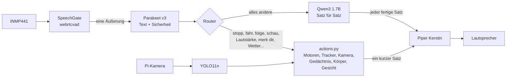
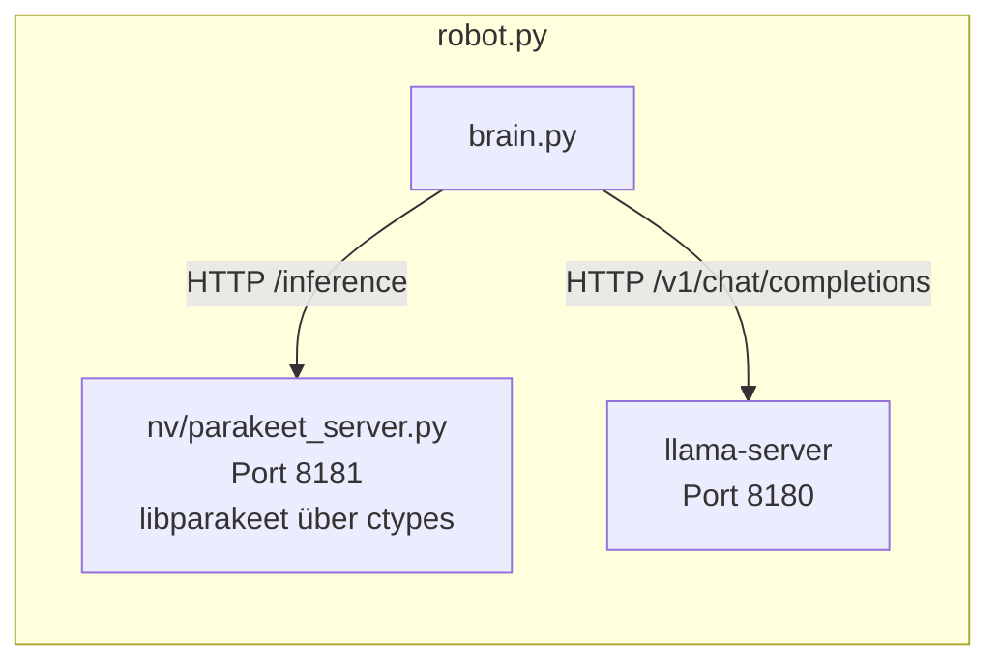

# NeuroVision local – Deutsch

Der NeuroVision-Kettenroboter mit seinem Gehirn auf dem Raspberry Pi 4, **komplett auf Deutsch**: er versteht Deutsch,
spricht Deutsch (Frauenstimme) und schreibt Deutsch auf sein Display. Keine Cloud, kein API-Schlüssel.

Dieser Zweig (`deutsch`) ist eine Kopie der englischen Version (`main`, Tag `stable-2026-10-28b`); die englische Version
bleibt unverändert. Auf dem Pi liegen beide nebeneinander: `~/projects/neurovision-local` (Englisch) und
`~/projects/neurovision-local-deutsch` (Deutsch).

| Aufgabe | Englische Version | Deutsche Version |
|---|---|---|
| Hören | Whisper base Q5_0 | **NVIDIA Parakeet TDT 0.6B v3** (q4_k, `libparakeet` aus whisper.cpp) |
| Denken, Plaudern | Qwen3 1.7B Q4_K_M | **Qwen3 1.7B Q4_K_M**, deutscher System-Prompt |
| Roboterbefehle | englischer Wort-Router | **deutscher Wort-Router** (`nv/router.py`, auch „Sie“-Form) |
| Sprechen | Piper `en_US-lessac-medium` | **Piper `de_DE-kerstin-low`** (offizielle Piper-Frauenstimme) |
| Sehen (`look`) | YOLO11n → englische Liste | YOLO11n → deutsche Sätze mit Artikel und Fall („eine rote Tasse links“) |
| Wetter, Wikipedia | Englisch | Open-Meteo auf Deutsch, deutsche Wikipedia |

Die Hardware ist unverändert NeuroVision: gleiche Pins, Treiber und Einstellungen (INMP441, MAX98357A, ST7789,
MX1508, Pi-Kamera, Tracking, WLAN-Portal, Boot-Bildschirm).

## Ablauf





### Warum Parakeet statt Whisper

Gemessen auf dem Roboter (20 deutsche Sätze, über den Robotlautsprecher abgespielt und mit dem INMP441 aufgenommen):

| Modell | Wörter richtig | Sätze exakt | Zeit pro Satz |
|---|---|---|---|
| Whisper base Q5_0 (`-l de`) | 38 % | 2/20 | 3,7 s |
| Whisper small Q5_1 (`-l de`) | 49 % | 1/20 | 15,3 s |
| **Parakeet v3 q4_k** | **88 %** | **17/20** | **1,7 s** |
| Parakeet v3 q8_0 | 88 % | 17/20 | 1,7 s (668 MB statt 415 MB) |

whisper.cpp baut `libparakeet.so`, aber keinen Server dafür. `nv/parakeet_server.py` lädt die Bibliothek mit `ctypes`,
hält das Modell im Speicher und antwortet wie `whisper-server` (gleiches `/inference`, gleiche Felder), damit
`SpeechToText` gleich bleibt. Die Sicherheit ist der Mittelwert der Token-Log-Wahrscheinlichkeiten: richtig gehörte
Sätze lagen bei −0,00 bis −0,16, falsch gehörte bei −0,7 bis −1,0. Befehle brauchen ≥ −0,5, Ausschalten und Vergessen
≥ −0,35, Plaudern ≥ −0,6; sonst fragt der Roboter nach.

Parakeet erkennt 25 Sprachen selbst und schreibt einen kurzen deutschen Befehl manchmal englisch („Fahr vorwärts.“ →
„Far forwards.“). Der Router versteht darum auch die englischen Richtungswörter.

### Die Stimme

Piper 1.3 zerlegt das „ç“ (der Ich-Laut in „ich“, „nicht“, „mich“) in „c“ und eine Cedille, die die Stimme nicht kennt:
„ich“ klang wie „ick“. `TextToSpeech` fügt solche Paare wieder zusammen.

## Was man sagen kann

| Sagen | Macht |
|---|---|
| „Stopp!“, „Halt!“, „Bleib stehen“, „Halten Sie an“ | Motoren und Tracking aus |
| „Fahr ein bisschen vorwärts“, „Dreh dich langsam nach links“, „Fahr zwei Sekunden zurück“ | `move` (0,25–3 s; ein bisschen = 0,3 s) |
| „Folge mir“, „Verfolge die rote Tasse“, „Folge dem blauen Ding“, „Schau mich an“ | `track` |
| „Dreh dich zur Flasche“, „Schau auf den Laptop“ | einmal zum Gegenstand drehen |
| „Was siehst du?“, „Siehst du ein Handy?“ | „Ich sehe eine Person vor mir und eine rote Tasse links.“ |
| „Lauter“, „Stell die Lautstärke auf sechzig“, „Fahr ab jetzt langsamer“ | Lautstärke, Motorgeschwindigkeit (gespeichert) |
| „Wie warm bist du?“, „Wie geht es dir?“, „Wie ist dein WLAN?“ | `body_status` |
| „Lächle“, „Schau überrascht“ | Gesichtsausdruck |
| „Merk dir, dass meine Schlüssel in der blauen Schale sind“, „Ich heiße Mustafa“, „Ich wohne in München“ | in `data/memory.db` |
| „Wo sind meine Schlüssel?“, „Wer bin ich?“, „Vergiss meine Schlüssel“ | Gedächtnis suchen / löschen |
| „Wie wird das Wetter morgen in Berlin?“ | Open-Meteo (Ort aus dem Gedächtnis, wenn keiner genannt) |
| „Wer war Albert Einstein?“, „Schlag schwarze Löcher nach“ | deutsche Wikipedia |
| „Wie spät ist es?“ | Uhr und Datum |
| „Fahr das System herunter“, „Schalte dich aus“ | Pi ausschalten / Programm beenden |
| alles andere | Qwen plaudert |

Gespeicherte Fakten zitieren den Nutzer („Der Nutzer sagte: „Ich heiße Mustafa.““), damit Qwen „mein Name“ nicht für
seinen eigenen Namen hält; vorgelesen werden sie in der Du-Form („Du heißt Mustafa.“).

## Gemessen auf dem Roboter (Pi 4)

| | |
|---|---|
| Start bis „Ich bin bereit.“ | ~10–14 s bei warmem Cache (Parakeet lädt in ~5 s) |
| Befehl, vom Ende der Äußerung bis zur Antwort | **~2 s** (Whisper-Version: ~4 s) |
| Plaudern, erster gesprochener Satz | 3,5–5 s nach der Erkennung; ganze Runde 6–15 s |
| Qwen auf Deutsch | 3,3 Token/s, wie auf Englisch |
| Router (`tests/test_router.py`) | 97/97 |
| RAM | ~2,2 GB: Qwen 1,5 GB, Parakeet 0,47 GB, Roboter 0,21 GB |

## Einrichtung

Gleiche Binärdateien wie die englische Version (Pfade in `config.toml` `[local]`):

```bash
# Parakeet v3 (q4_k) von ggml-org/parakeet-GGUF:
cd ~/whisper.cpp/models && curl -LO https://huggingface.co/ggml-org/parakeet-GGUF/resolve/main/ggml-parakeet-tdt-0.6b-v3-q4_k.bin
# Kerstin (Piper):
mkdir -p ~/neurobrain/tts/de && cd ~/neurobrain/tts/de
curl -LO https://huggingface.co/rhasspy/piper-voices/resolve/main/de/de_DE/kerstin/low/de_DE-kerstin-low.onnx
curl -LO https://huggingface.co/rhasspy/piper-voices/resolve/main/de/de_DE/kerstin/low/de_DE-kerstin-low.onnx.json

cd ~/projects/neurovision-local-deutsch
uv venv --system-site-packages --python /usr/bin/python3 .venv
uv pip install --python .venv/bin/python -r requirements.txt
bash deploy/get-model.sh
```

## Starten

```bash
.venv/bin/python robot.py                            # Roboter-Hardware
.venv/bin/python -m tests.test_router                # Router-Test ohne Hardware
.venv/bin/python -m tests.e2e_voice config.dev.toml  # Sprachtest über den Lautsprecher (Thorsten-Stimme)
```

Als Dienst beim Einschalten (beendet die englische und die Gemini-Version und nimmt sie aus dem Autostart):

```bash
bash deploy/install-service.sh
systemctl --user status neurovision-local-deutsch
tail -f logs/robot.log
```

Zurück zur englischen Version:

```bash
systemctl --user disable --now neurovision-local-deutsch
systemctl --user enable --now neurovision-local
```

## Dateien

| Datei | Rolle |
|---|---|
| `nv/router.py` | deutsche Befehle → NeuroVision-Werkzeuge |
| `nv/actions.py` | führt die Werkzeuge aus, schreibt die deutschen Antworten |
| `nv/german.py` | **neu** – deutsche Nomen mit Geschlecht, Farben, Artikel, Fälle, Zahlwörter („sechzig“ → 60) |
| `nv/parakeet_server.py` | **neu** – Parakeet als HTTP-Server (ctypes, `libparakeet.so`) |
| `nv/local_ai.py` | startet llama-server und Parakeet; Piper mit Ich-Laut-Korrektur |
| `nv/brain.py`, `nv/tracker.py`, `nv/web.py` | deutsche Sätze, deutsche Füllwörter, deutsches Wetter und Wikipedia |
| `deploy/neurovision-local-deutsch.service` | Benutzerdienst (`Conflicts=` mit der englischen und der Gemini-Version) |

## Grenzen

- Parakeet erkennt die Sprache selbst; kurze Befehle mit Akzent kommen manchmal in einer anderen Sprache heraus. Die
  Sicherheitsprüfung fängt das ab: der Roboter fragt nach, statt zu raten.
- Qwen3 1.7B spricht ordentliches, aber einfaches Deutsch und kann Fakten erfinden.
- `look` kennt nur die 80 COCO-Klassen und Farben.
