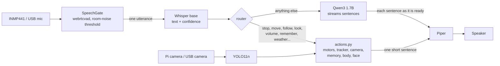

# NeuroVision local

The NeuroVision tracked robot with its brain on the Raspberry Pi: no cloud, no API key.
It starts from the latest NeuroVision (`neurovision-gemini` `a933eb1`, the version running on the Zero 2W) and replaces
Gemini Live with three local models:

| Job | NeuroVision | NeuroVision local |
|---|---|---|
| Hearing | Gemini Live | **Whisper base Q5_0** (whisper.cpp) |
| Thinking, chat | Gemini Live | **Qwen3 1.7B Q4_K_M** (llama.cpp) |
| Robot commands | Gemini function calls | **keyword router** (`nv/router.py`) → NeuroVision's own modules |
| Speaking | Gemini voice | **Piper** `en_US-lessac-medium` |
| Seeing (`look`) | camera frame to Gemini | **YOLO11n** (NeuroVision's tracker model) → spoken object list |
| Language | Turkish | English |

The hardware side is NeuroVision unchanged: same pins, same drivers and tuning (INMP441 mic, MAX98357A amp,
ST7789 face, MX1508 tracks, Pi camera, tracking, Wi-Fi portal, boot splash). Runs on a **Pi 4 (4 GB)**; the models need
about 2 GB of RAM, more than a Zero 2W has.

## How it works



Measured with Qwen3 1.7B on a Pi 4, letting the LLM choose tools took **7–13 s per command** (even "Stop!") and picked
the right tool 9 times out of 12. The router understands a command instantly, so a command costs only speech
recognition. The LLM only chats; it gets no tool list, which also made its answers better.

- **Confidence check.** Whisper's `avg_logprob` comes with every utterance. Commands that change something (move, follow, remember,
  volume, shutdown...) need ≥ −0.5, chat needs ≥ −0.6; otherwise the robot asks again instead of acting on a guess.
  "Stop" is never blocked. Short mishearings of it ("Top!", "Shop") also stop the robot, because stopping is always safe.
- **Half duplex**, as in NeuroVision: while the robot speaks or its motors run, the microphone is ignored.
- **Notes for the LLM.** Up to two memories matching the question's content words, and what the robot saw in the last
  two minutes, are added to the question. The whole memory list is not added: every 8 tokens cost about 1 s on the Pi 4.
- **Streaming.** Qwen's answer is spoken sentence by sentence; Piper prepares the next sentence while the speaker plays.
- **Servers.** `robot.py` starts `llama-server` (port 8180) and `whisper-server` (8181) while it opens the hardware, and stops them on exit.
  The ports differ from NeuroBrain's, so neither kills the other's servers.

## What you can say

| Say | Does |
|---|---|
| "Stop!", "Stop following me" | stops motors and tracking |
| "Go forward a little", "Turn left slowly", "Back up for two seconds" | `move` (0.25–3 s; a little = 0.3 s) |
| "Follow me", "Track the red cup", "Follow the blue thing", "Look at me" | `track` (turns in place) |
| "Turn to the bottle", "Face the laptop" | one turn toward an object |
| "What do you see?", "Do you see a phone?" | YOLO11n: "I can see a person in front of me and a red cup on the left." |
| "Louder", "Set the volume to 40", "Move slower from now on" | speaker volume, motor speed level (both remembered) |
| "How hot are you?", "How are you feeling?", "How is your Wi-Fi?" | `body_status` |
| "Smile", "Look surprised" | face expression |
| "Remember that my keys are in the blue bowl", "My daughter's name is Elif", "I live in Izmir" | saved to `data/memory.db` |
| "Where are my keys?", "What do you remember about Elif?", "Forget about my keys" | memory search / delete |
| "What's the weather in Ankara?", "Will it rain tomorrow?" | Open-Meteo (needs internet; place from memory if not said) |
| "Who was Albert Einstein?", "Look up black holes" | English Wikipedia (without internet the LLM answers) |
| "What time is it?" | local clock |
| "Shut down the system", "Turn yourself off" | power off the Pi / stop the program |
| anything else | Qwen chat |

## Measured on the Pi 4 (bench: C270 USB webcam, speaker, questions played through the speaker)

| | |
|---|---|
| Start to listening | ~17 s (models load while the hardware opens; system prompt cached in ~6.5 s) |
| Command, from end of speech to the robot's answer | **~4 s** (3.7–4 s of it is Whisper) |
| Chat, first spoken sentence | 3.5–9 s after recognition; whole turn 7–15 s |
| Router accuracy (66 test sentences, `tests/test_router.py`) | 66/66 |
| Voice test (`tests/e2e_voice.py`, 14 questions) | 14/14 heard; 12 answered right; "bowl" heard as "ball" once; a one-word "Stop." heard as "Don't!" was asked again |
| RAM | ~2.0 GB: Qwen 1.55 GB, robot 0.27 GB, Whisper 0.13 GB |

## Setup

The models and binaries are the ones NeuroBrain uses on this Pi (paths in `config.toml` `[local]`):

```bash
# llama.cpp and whisper.cpp built in ~/neurobrain/llama.cpp and ~/whisper.cpp
# Qwen3 1.7B Q4_K_M:  ~/neurobrain/models/qwen3-1.7b-q4km.gguf
# Whisper base Q5_0 (made locally from ggml-base.bin):
cd ~/whisper.cpp/models && ../build/bin/whisper-quantize ggml-base.bin ggml-base-q5_0.bin q5_0
# Piper voice: ~/neurobrain/tts/en_US-lessac-medium.onnx (+ .json)

cd ~/projects/neurovision-local
uv venv --system-site-packages --python /usr/bin/python3 .venv   # lgpio and Pillow come from the system
uv pip install --python .venv/bin/python -r requirements.txt
bash deploy/get-model.sh                                         # YOLO11n -> models/yolo11n_320.onnx
```

Robot hardware: as in NeuroVision (`deploy/hw-setup.sh`, `deploy/asoundrc`, `deploy/boot-config.txt`). On this Pi 4,
`/boot/firmware/config.txt.neurovision` holds the robot audio settings; the current `config.txt` is set up for NeuroBrain
(C270 and headphone output).

## Running

```bash
.venv/bin/python robot.py --config config.dev.toml   # Pi 4 bench: C270 camera + mic, default speaker, no face, no motors
.venv/bin/python robot.py                            # robot hardware (config.toml)
.venv/bin/python robot.py --check                    # hardware test: mic, speaker, camera
.venv/bin/python -m tests.test_router                # router test, no hardware
.venv/bin/python -m tests.e2e_voice config.dev.toml  # voice test through the speaker
```

As a service (replaces the Gemini service while it runs: `Conflicts=neurovision.service`):

```bash
bash deploy/install-service.sh
systemctl --user status neurovision-local
tail -f logs/robot.log            # every turn: what was heard, confidence, route, answer, timings
```

Logs: `logs/robot.log`, `logs/llm-server.log`, `logs/stt-server.log`; the last 10 utterances as WAV in `logs/debug/`.

## Files

| File | Role |
|---|---|
| `robot.py` | Start-up: local AI servers, hardware, brain; `--check` |
| `config.toml` / `config.dev.toml` | Robot hardware / Pi 4 bench (only audio devices, camera backend, face and motors differ) |
| `nv/brain.py` | **new** – listen → recognise → route → act or chat → speak (replaces `live.py`) |
| `nv/router.py` | **new** – English commands → NeuroVision tools |
| `nv/actions.py` | **new** – runs the tools, writes the spoken English answers (replaces `tools.py`) |
| `nv/local_ai.py` | **new** – llama-server / whisper-server processes, Whisper client, Qwen streaming, Piper |
| `nv/camera.py` | NeuroVision + `backend = "v4l2"` for a USB camera (same MJPEG stream through ffmpeg) |
| `nv/tracker.py` | NeuroVision; tracking events are spoken English sentences |
| `nv/web.py` | NeuroVision; English place names, weather words and Wikipedia |
| `nv/audio.py`, `vad.py`, `display.py`, `motors.py`, `vision.py`, `body.py`, `memory.py`, `debug.py` | NeuroVision, unchanged |
| removed | `live.py`, `tools.py`, `summarizer.py` (Gemini), `radio.py` (was off), `lang.py` (Turkish check) |

## Limits

- Qwen3 1.7B produces ~3 tokens/s on the Pi 4, so chat answers take a few seconds and are kept to two short sentences.
  It can invent facts; the confidence check keeps the worst misheard questions away from it.
- Whisper base still mishears names ("Izmir" → "his mirror") and short words.
- `look` names only the 80 COCO object classes plus colours; it cannot describe a scene. A vision LLM (Qwen3.5 2B)
  took 25–37 s per frame on the Pi 4.
- No automatic memory summaries yet (Gemini Flash-Lite did that); facts are saved when you ask.
- While the motors run the microphone is off (as in NeuroVision), so "stop" is heard between moves; a move lasts at most 3 s.
